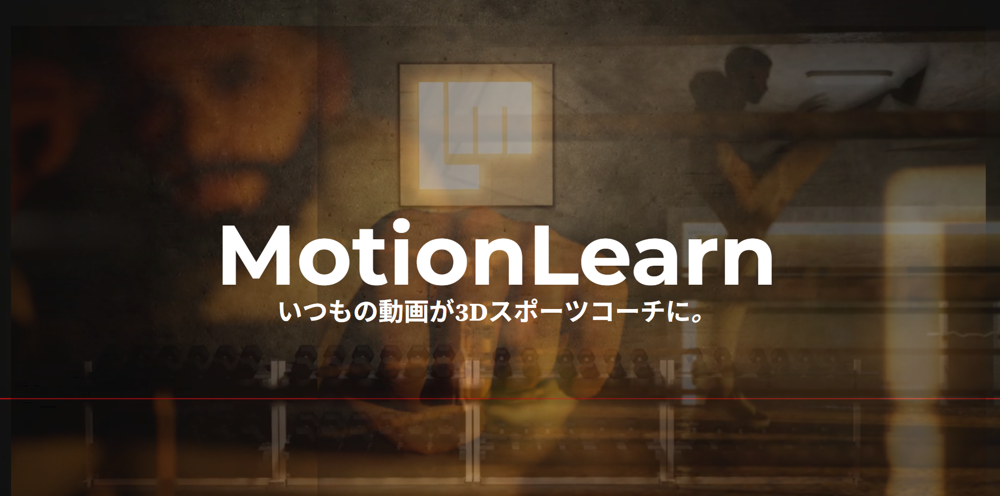
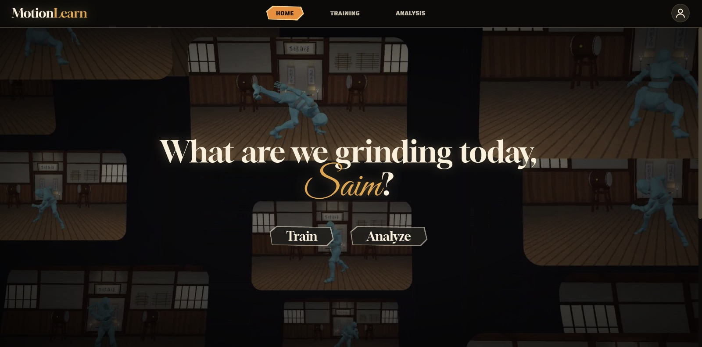
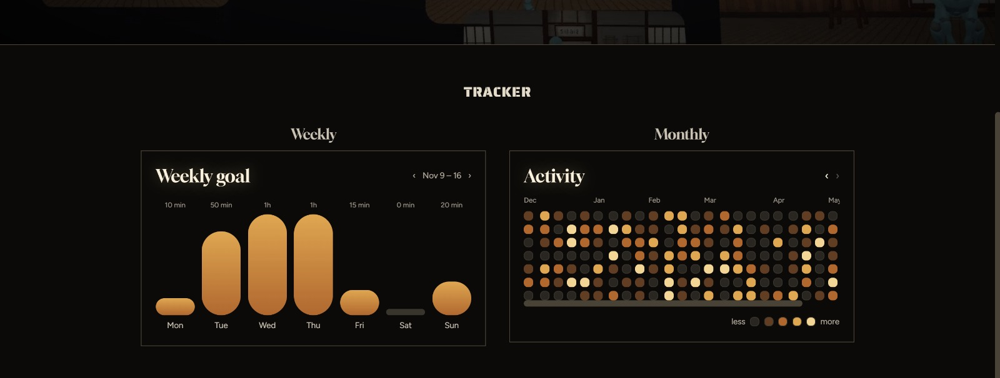
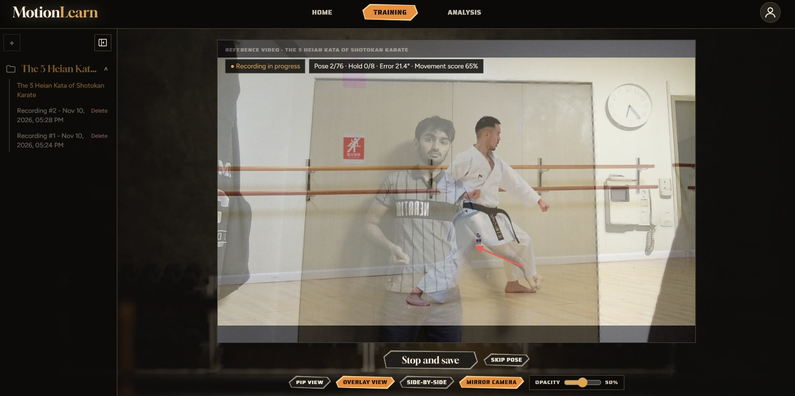
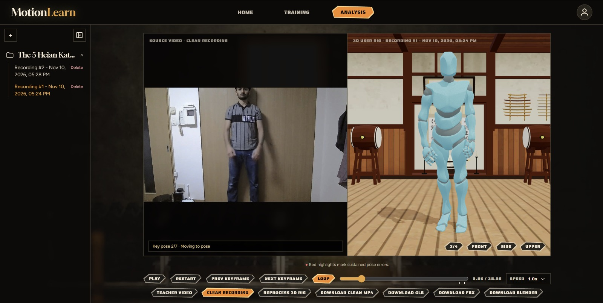
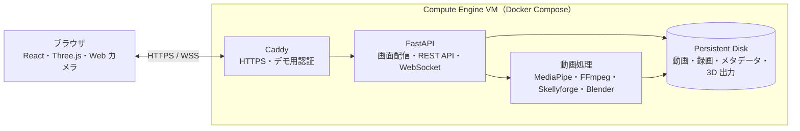

# MotionLearn

**いつもの動画が3Dスポーツコーチに。**



MotionLearnのURLはこちらからアクセス: [MotionLearn デモ](https://35.200.34.115/) 

## チーム情報

| 項目 | 内容 |
| --- | --- |
| イベント | DevFest GDGoC Japan 2026 Hackathon |
| 参加形式 | オンライン |
| チーム | Seafood Biryani（シーフードビリヤニ） |
| メンバー | アフメド サイム、ナウラ アリンドラ サルワ、宮本 智里、スーラーシー デイーラプラツアンクル |
| カテゴリ | 教育（Education） |

## 1. 製品概要

MotionLearn は、空手やダンスなどの動きを、お手本動画と Web カメラを使って練習できる Web アプリです。動画から動きの要点となる姿勢（キーポーズ）を抽出し、練習中は関節をどちらに動かせばよいかを画面上の矢印で示します。練習後は、自分の録画と、その動きを再現した 3D アバターを同期再生してフォームを振り返れます。

身近な動画とカメラで、指導者がそばにいないときにもフォームを見直せる練習環境を提供し、SDG 4「質の高い教育をみんなに」への貢献を目指します。

## Web アプリの画面

### Home（ホーム）

道場を背景にした映像と、練習を始める **Train**、録画を振り返る **Analyze** のボタンが表示されます。上部のナビゲーションからも 3 つの画面を行き来できます。下へスクロールすると、サンプルデータを使った週間グラフと月間ヒートマップが **Tracker** に表示されます。





### Training（トレーニング）

- **動画ライブラリ** — 左側のサイドバーでお手本を選びます。動画ファイルのアップロードや、取得可能な YouTube 動画の取り込みもできます。キーポーズが未抽出の場合は **Extract keyposes** から処理を開始します。
- **お手本とカメラ映像** — お手本動画とカメラ映像の表示を、子画面・重ね合わせ・横並びから選べます。左右反転や、重ね合わせ時の透明度を調整できます。お手本がキーポーズで停止したら、矢印を参考に姿勢を合わせて一定時間保つと、再生が進みます。
- **練習操作** — **Start recording** で練習を始め、キーポーズの停止中は **Skip pose** で次に進めます。**Stop and save** で補正表示の入っていないカメラ映像を保存し、Analysis 画面に移動します。



### Analysis（分析）

- **録画ライブラリ** — 左側のサイドバーで練習の録画を選びます。手持ちの動画を直接アップロードして 3D 化することもできます。
- **映像と 3D リグ** — 録画を左、同じ動きを再現する 3D アバターを右に表示します。未生成の場合は **Generate 3D rig** で処理を始められます。生成後は共通のタイムラインで映像と 3D を同期再生し、視点を変えてフォームを確認できます。
- **比較と書き出し** — 同期情報がある練習録画では、**Teacher Video** で左側をお手本動画に切り替えられます。一定時間続いた姿勢のずれは、アバター上で赤く表示します。録画は MP4、生成された 3D データは GLB・FBX・Blender 形式でダウンロードできます。



## 2. 課題と対象ユーザー

### 2.1 対象ユーザー

動画を見て独学する人、アマチュアの選手やダンサー、指導を受ける合間に自宅で練習したい人を想定しています。

### 2.2 課題と開発のきっかけ

お手本動画を見ながら一人で練習すると、腕や脚の角度がどのくらいずれているかを自分で判断する必要があります。短い区間を繰り返すたびに、再生や巻き戻しの操作も必要です。チームメンバーのサイムが、一人で空手の型を練習する際に細かなフォームのずれを見つけにくかったことが、開発のきっかけです。

### 2.3 一般的な動画練習との違い

| 観点 | 一般的な動画練習 | MotionLearn |
| --- | --- | --- |
| 再生操作 | 自分で停止し、練習したい箇所まで戻る | キーポーズで自動停止し、姿勢を合わせて保つと再開する |
| 練習中のフィードバック | 自分の姿勢とお手本を目視で見比べる | 関節を動かす方向がリアルタイムに表示される |
| 練習後の振り返り | 撮影した視点から録画を見直す | 録画と 3D アバターを同期し、視点を変えて確認できる |

## 3. Google 技術の活用

| 技術 | 利用箇所 | 採用理由と運用上の考慮点 |
| --- | --- | --- |
| Google MediaPipe | お手本と学習者の姿勢推定、任意のハンドジェスチャー認識、3D 化のためのランドマーク抽出 | 一般的な動画や Web カメラ映像から姿勢を推定できる。全身の映り方や遮蔽によって検出品質が変わる |
| Google Compute Engine | Docker Compose による Web アプリと動画処理環境の稼働 | FFmpeg とヘッドレス Blender を同じ VM で実行できる。VM の保守が必要 |
| Persistent Disk | お手本、録画、メタデータ、3D 出力の保存 | コンテナを再起動してもデータを保持できる。バックアップは別途管理する |

## 4. アーキテクチャ



| ディレクトリ | 役割 |
| --- | --- |
| [final-web-app/](final-web-app/) | React フロントエンド、FastAPI バックエンド、WebSocket による練習セッション |
| [Motion_Capture/](Motion_Capture/) | ランドマーク抽出・補正と Blender による 3D リグの生成 |
| [utilities/](utilities/) | キーポーズ抽出、ジェスチャー認識、動作の採点 |
| [deploy/](deploy/) | ローカル起動手順、Docker Compose、Compute Engine の構成 |

## 5. 起動と動作確認

### 5.1 ローカル起動

Node.js 22、Python 3.11、FFmpeg、Blender を用意します。Python 仮想環境の設定と、3D 生成用の MediaPipe・Skellyforge 環境の準備は [運用ガイド](deploy/README.md#local-development) に従ってください。

リポジトリ直下で API を起動します。次は PowerShell の例です。

```powershell
python -m pip install -r deploy/requirements.txt
$env:MOTIONLEARN_DATA_DIR = ".motionlearn-data"
python final-web-app/run_server.py
```

別のターミナルでフロントエンドを起動し、Vite が表示するローカル URL をブラウザで開きます。

```powershell
cd final-web-app
npm ci
npm run dev
```

### 5.2 サンプルで確認する

1. **Train** を開き、**Sample Video (captured_vid)** を選びます。同梱のサンプルには抽出済みのキーポーズが 8 個あります。
2. **Start recording** を押し、カメラの利用を許可して、全身が映る位置に立ちます。
3. お手本がキーポーズで止まり、姿勢を合わせて保つと再生が再開することを確認します。関節をお手本の位置からずらして補正矢印の表示を確認します。
4. キーポーズで停止している間に **Skip pose** を選び、次のキーポーズへ進めることを確認します。
5. 練習を終えるか **Stop and save** を押します。Analysis で必要に応じて **Generate 3D rig** を押し、生成後にタイムラインを動かして、録画と 3D アバターが同期することを確認します。

初期ライブラリにはお手本動画のみが入っています。手順 5 で保存した録画を、分析用のサンプルとして使えます。

## ライセンス

[MIT License](LICENSE)
